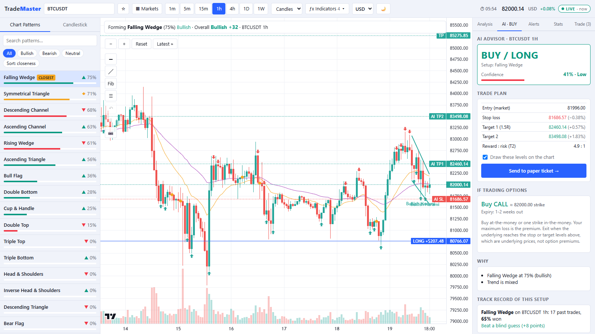

# TradeMaster – All-in-One Trading Analysis Platform

TradeMaster is an interactive trading analysis platform for **crypto, stocks, forex, and other supported markets**. It combines interactive charts, automated pattern detection, technical indicators, AI-assisted insights, and historical strategy analytics to help traders make informed decisions.

## 🚀 Key Features

- **Multi-Market Analysis:** Analyze cryptocurrencies, stocks, forex, and other supported instruments.
- **Interactive Charts:** Explore candlestick charts, timeframes, and volume data.
- **Chart Pattern Recognition:** Detect patterns such as triangles, wedges, channels, double tops, double bottoms, and head and shoulders.
- **AI-Powered Insights:** Generate market analysis, potential bullish or bearish signals, and Buy, Sell, or Wait guidance.
- **Technical Indicators:** Analyze market trends and momentum using EMA20, EMA50, and other supported indicators.
- **Candlestick Pattern Detection:** Identify potential market reversal and continuation patterns.
- **Trade Planning:** Visualize entry prices, take-profit targets, and stop-loss levels.
- **Strategy Backtesting:** Evaluate historical trading signals, win rates, profit factors, and strategy performance.
- **Customizable Workspace:** Switch between instruments, timeframes, chart styles, and analysis tools.

## 📸 Screenshots

> Screenshots use live market data and a demo paper-trading account with virtual money.

### Live chart with pattern detection and the AI advisor
Closest chart pattern, buy/sell candlestick signals, and a trade plan with entry, stop loss and targets drawn on the chart.


### Paper trading
Open positions with a stop-to-target progress bar, live profit and loss after fees, and market, limit and stop orders.


### Indicators and drawing tools
Bollinger Bands, VWAP, support/resistance levels, RSI and MACD panels, plus trend line and Fibonacci drawing tools.


### Market scanner
Scan a whole market (crypto, stocks, forex, commodities) for the best chart patterns and AI setups on any timeframe.


### Performance stats and strategy tester
Your paper-trading results, and a tester that replays the AI advisor on past candles with real stop and target exits, so you can see honestly whether a strategy worked.


### India (NSE) options chain
Nifty, Bank Nifty and F&O stock option chains with a paper-trade ticket.


### Light mode
Switch between dark and light themes, and between display currencies (USD, INR, EUR, GBP and more).



## 🎯 Our Mission

To simplify technical analysis by bringing charting tools, automated pattern recognition, AI-assisted insights, and strategy analytics into one convenient platform.

TradeMaster helps traders analyze market trends, evaluate potential opportunities, and approach trading with a more structured strategy.

## 🛠️ Technology

The technology stack depends on the project's implementation and may include:

- Frontend and interactive charting
- Market data APIs
- Technical analysis algorithms
- AI integration
- Historical market data and backtesting

## ⚠️ Disclaimer

TradeMaster is an analytical tool, not a financial advisor. Its signals and AI-generated insights may be inaccurate and do not guarantee profits. Trading involves financial risk, and users should conduct their own research before making investment decisions.

---

**Trade smarter. Analyze deeper. Trade with confidence.**

## 📦 Getting Started

The app lives in the `web/` folder (React + TypeScript + Vite, charts by [lightweight-charts](https://github.com/tradingview/lightweight-charts)).

```bash
cd web
npm install
npm run dev        # opens on http://localhost:5173
```

Requires Node.js 18 or newer. Other scripts: `npm run build` (type-check and production build) and `npm run preview`.

> Stock, forex, futures and options data come through small proxy routes in `web/vite.config.ts`, so run the app with `npm run dev` (or `npm run preview`). Crypto data comes straight from Binance and works anywhere.

### Project layout

```
web/
  src/
    App.tsx              main screen and live-data wiring
    components/          chart, trade panel, AI advisor, scanner, stats, ...
    engine/              pattern detection, AI advisor, backtest and strategy tester (runs in a Web Worker)
    data.ts              Binance, Yahoo Finance and NSE data feeds
    paper.ts             paper-trading account (orders, fees, trailing stops, P&L)
    fx.ts                live currency conversion
  vite.config.ts         dev-server proxies for Yahoo Finance and NSE data
```

### Also included

- Paper trading with virtual money: market, limit and stop orders, stop loss, take profit, trailing stops and fees.
- Strategy tester, performance stats, market scanner, price and pattern alerts, watchlist.
- Drawing tools (trend line, horizontal line, Fibonacci), Bollinger Bands, VWAP, RSI, MACD and support/resistance levels.
- Display currency switcher (USD, INR, EUR, GBP and more) with live exchange rates.
