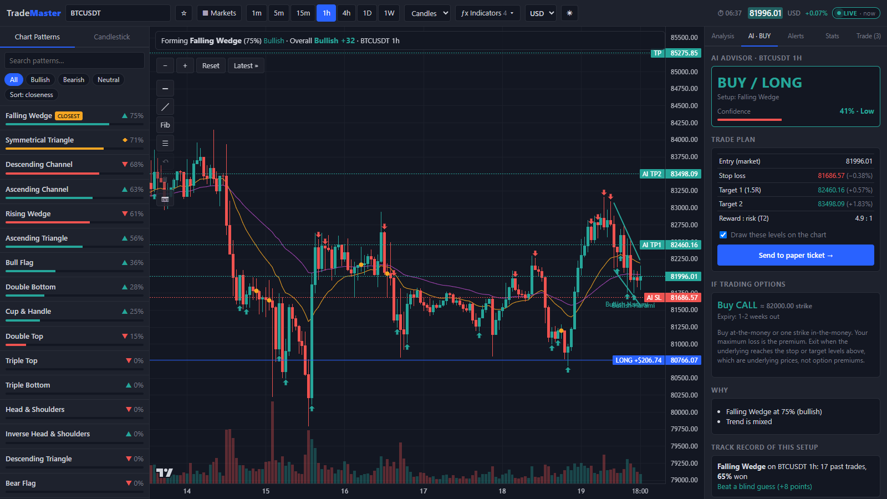
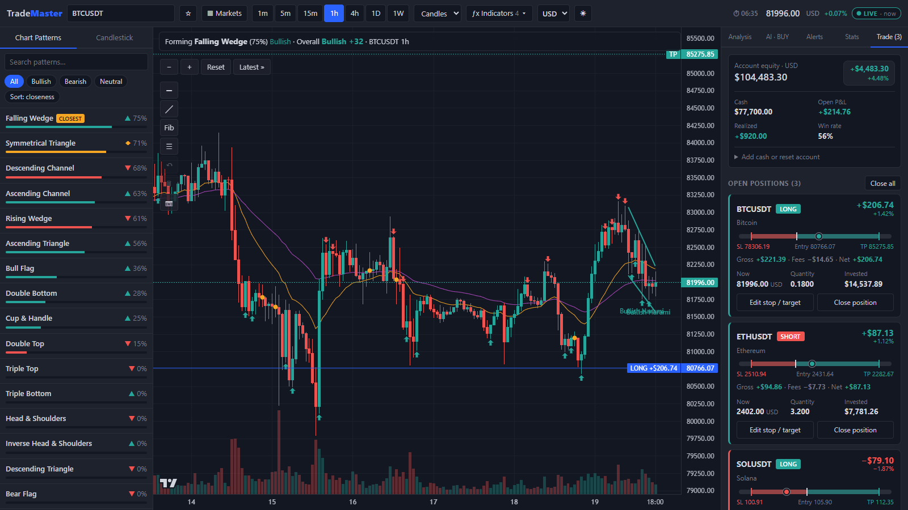
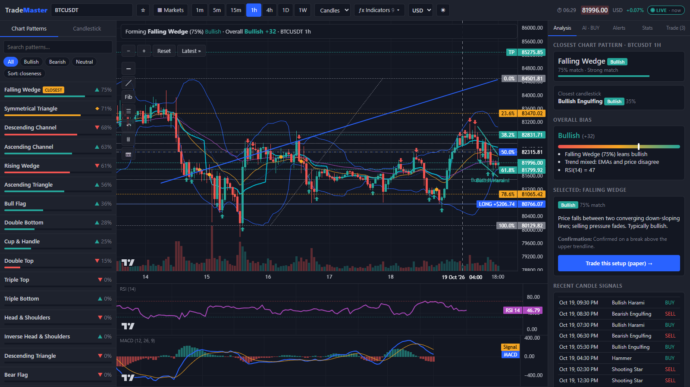
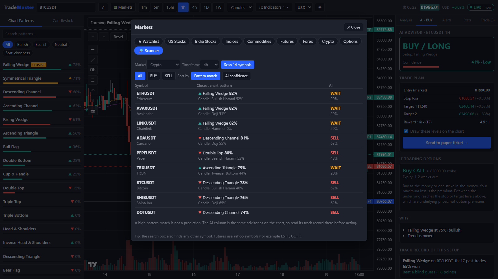
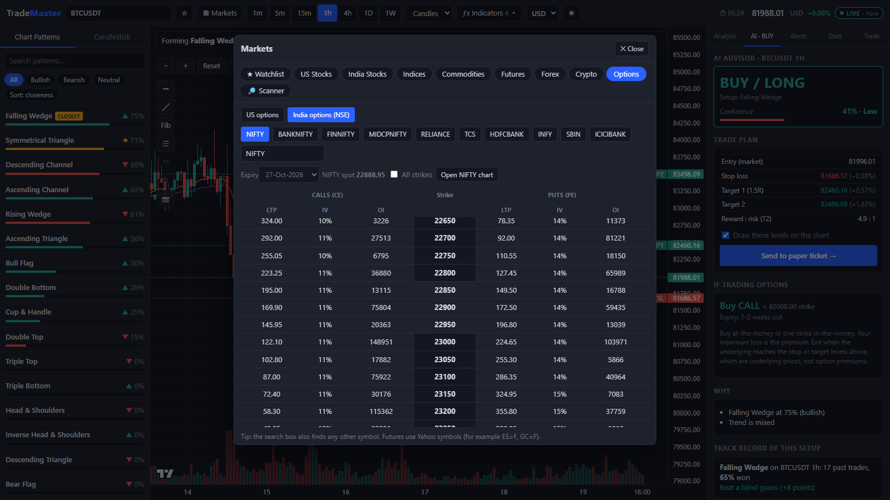
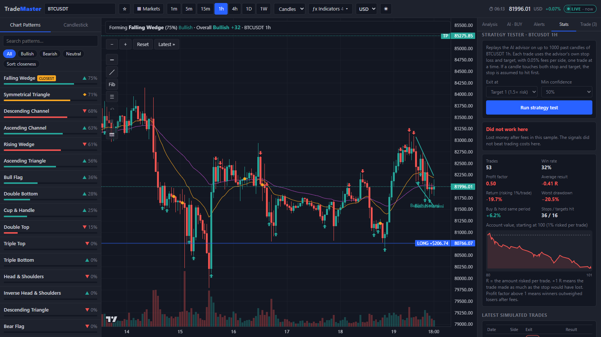

# TradeMaster User Guide

A beginner-friendly tour of TradeMaster: what you are looking at, how to read it, and how to practise trading with virtual money before risking anything real.

> **Important:** TradeMaster is an analysis and practice tool, not a financial advisor. Its patterns, signals and AI suggestions can be wrong and do not guarantee profit. Everything you trade inside the app is **paper trading with virtual money**.

## Contents

1. [Start the app](#1-start-the-app)
2. [A tour of the screen](#2-a-tour-of-the-screen)
3. [Your first 10 minutes](#3-your-first-10-minutes)
4. [How to read the numbers](#4-how-to-read-the-numbers)
5. [Paper trading in detail](#5-paper-trading-in-detail)
6. [Chart tools](#6-chart-tools)
7. [Finding opportunities](#7-finding-opportunities)
8. [Testing before trusting](#8-testing-before-trusting)
9. [Troubleshooting and FAQ](#9-troubleshooting-and-faq)
10. [Glossary](#10-glossary)

---

## 1. Start the app

You need [Node.js](https://nodejs.org) 18 or newer.

```bash
cd web
npm install
npm run dev
```

Open **http://localhost:5173** in your browser (Chrome or Edge work best).

Use `npm run dev` (not just opening a file). Stock, forex, futures and options data are fetched through small helper routes that only exist while the dev server is running. Crypto works anywhere.

---

## 2. A tour of the screen



### Top bar

| Control | What it does |
|---|---|
| **Search box** | Type a symbol or name: `BTCUSDT`, `AAPL`, `RELIANCE.NS`, `EURUSD=X`, `gold`, `nifty`. Pick from the list. |
| **☆ star** | Save the current symbol to your watchlist. |
| **▦ Markets** | Browse stocks, indices, commodities, futures, forex, crypto, options, and the market scanner. |
| **1m 5m 15m 1h 4h 1D 1W** | Timeframe: how much time one candle covers. Start with **1h** or **1D**. |
| **Candles / Line / Area** | Chart style. |
| **ƒx Indicators** | Switch on Bollinger Bands, VWAP, support/resistance, RSI and MACD panels, EMA lines and volume. |
| **USD ▾** | Display currency (USD, INR, EUR, GBP and more). All your account values convert at live rates. |
| **☀ / 🌙** | Light or dark theme. |
| **Price, ⏱, LIVE** | Current price, time left until the current candle closes, and the data status (see [FAQ](#9-troubleshooting-and-faq)). |

### Left panel: the pattern menu

Lists every chart pattern (triangles, wedges, channels, double tops and bottoms, head and shoulders, flags, cup and handle) and every candlestick pattern, each with a **match percentage**: how closely the recent price action looks like that textbook shape. The best match is tagged **CLOSEST**. Click any pattern to draw it on the chart and read what it means. Use the filters to show only bullish, bearish or neutral patterns.

### Centre: the chart

- **Mouse wheel** zooms. **Drag** to pan. Drag the price or time axis to stretch it. Double-click an axis to reset it.
- Buttons at the top left: **−  +** (zoom), **Reset**, **Latest »** (jump to the newest candle).
- The toolbar below them holds the **drawing tools** (see [Chart tools](#6-chart-tools)).
- Arrows on candles are **buy (green) and sell (red) signals** from candlestick patterns.

### Right panel: five tabs

| Tab | Purpose |
|---|---|
| **Analysis** | The closest pattern, overall bias, what the pattern means, and recent candle signals. |
| **AI** | A suggested action (Buy / Sell / Wait) with stop loss and targets, and an honest record of how that kind of setup performed before. |
| **Alerts** | Get notified when a price level is hit or a pattern reaches a match percentage you choose. |
| **Stats** | Your paper-trading results and the strategy tester. |
| **Trade** | Your virtual account, open positions, pending orders and the order ticket. |

---

## 3. Your first 10 minutes

1. **Pick something liquid.** Search `BTCUSDT` (Bitcoin) or `AAPL` (Apple). Choose the **1h** timeframe.
2. **Read the banner** at the top of the chart. It says which pattern is forming, how closely it matches, and whether the overall bias is bullish, bearish or neutral.
3. **Open the Analysis tab.** Click the CLOSEST pattern in the left menu to see it drawn on the chart. Read its description and its confirmation rule (what price has to do before the pattern counts as confirmed).
4. **Open the AI tab.** Look at the suggested action and confidence, but read the two sections below it first: **Track record of this setup** and **Strategy check on this chart**. They show how this kind of signal actually did on this symbol in the past. If they say it lost money, treat the suggestion with suspicion.
5. **Practise a trade.** In the AI tab, click **Send to paper ticket**. This fills the **Trade** tab with a direction, stop loss and target. Check the amount, then press the green or red button. You have just opened a paper position.
6. **Watch it.** In **Trade → Open positions** your position has a bar from **stop loss** (left) to **target** (right). The dot is the current price: it moves right when you are winning and left when you are losing. The profit shown is already **after fees**.
7. **Close it** with **Close position** (click twice to confirm), or let the stop loss or target close it for you.
8. **Review.** Open **Stats** to see your win rate, profit factor and profit curve as you build up trades.

Do this many times before you trust any approach. A handful of trades tells you very little.

---

## 4. How to read the numbers

| You see | It means |
|---|---|
| **Match %** (for example "Falling Wedge 75%") | How closely recent prices resemble that pattern. It is **not** the chance that the trade will win. |
| **Bullish / Bearish / Neutral** | The direction the pattern usually points, based on textbook rules. |
| **Overall bias** (-100 to +100) | A blend of the best pattern, candle signals, trend (EMA 20 vs EMA 50) and RSI. |
| **AI action and confidence** | A rules-based suggestion with a confidence score. It is a checklist result, not a prediction. |
| **Track record of this setup** | How often this pattern won on this symbol and timeframe in recent history, compared with a blind guess. |
| **Strategy check** | The AI's trades replayed on past candles after fees. **Profit factor above 1 means winners outweighed losers**; below 1 means it lost money. |
| **R** (for example +1.5 R) | A multiple of the amount you risked. +1 R means you made as much as your stop loss would have lost. |
| **Reward : risk** | How much you stand to gain compared with how much you stand to lose if the stop is hit. Many traders look for at least 1.5 : 1. |

**Be honest with yourself about the AI.** It combines pattern match, trend, RSI, candle signals and swing levels, then lowers its confidence when a pattern lost money in the past. In the project's own tests across many crypto markets, its signals did **not** beat trading costs, and higher confidence did not mean higher win rate. Use it to organise your thinking, not as an oracle.

---

## 5. Paper trading in detail



You start with **$100,000** of virtual money. Add more or reset under **Trade → Add cash or reset account**.

### Placing an order

In **Trade → New order**:

1. Choose **Buy / Long** (you profit if the price rises) or **Sell / Short** (you profit if it falls).
2. Choose the order type:
   - **Market**: trade immediately at the current price.
   - **Limit**: trade only at a better price. A limit **buy** waits for the price to fall to your level; a limit **sell** waits for it to rise.
   - **Stop**: trade when the price breaks through a level. A stop **buy** triggers when price rises to your level; a stop **sell** when it falls to it.
3. Enter the **amount to invest** (in your display currency) or use the quick **% of cash** buttons.
4. Optionally set a **Stop loss** (closes the trade if the price goes against you), a **Take profit** (closes it when the target is reached) and a **Trailing stop** (a stop that follows the price at a distance you choose and never moves backward).
5. Check the preview: quantity, fees, and **what you gain or lose if the stop or target is hit**.

Pending limit and stop orders appear under **Pending orders** and as orange lines on the chart. You can cancel them at any time.

### Sizing by risk

Open **Size by risk**, enter the percentage of your account you are willing to lose on this trade (many people use 1%), set a stop loss, and press **Fill amount**. The app calculates the amount so that being stopped out loses about that share of your equity.

### Fees and currency

- Each trade pays a fee of **0.05% on entry and 0.05% on exit** by default. Change it in the account section. The profit shown on every position and in your history is **net of fees**, with the gross figure and the fees listed beside it, so there are no surprises.
- Your account is kept in US dollars and displayed in whichever currency you choose. A trade in a rupee-priced stock is converted at the live exchange rate, so currency moves affect your result just as they would in a real dollar account.

### Managing positions

Each open position has a card showing profit, the stop-to-target bar, quantity and amount invested. **Edit stop / target** changes the levels, **Close position** closes it, and **Close all** closes everything. Click a symbol name on a card to jump to its chart.

> Paper trading has no slippage (you always get the price you see) and stock prices may be delayed, so real trading will behave differently.

---

## 6. Chart tools



### Drawing tools (left edge of the chart)

| Button | Tool |
|---|---|
| **─** | Horizontal line: click once on the chart. |
| **╱** | Trend line: click two points. It extends to the latest candle. |
| **Fib** | Fibonacci retracement: click the start and end of a move. |
| **☰** | List of drawings, with a ✕ to delete each one. |
| **↶** | Undo the last drawing. |
| **🗑** | Delete all drawings on this symbol. |
| **📷** | Save a picture of the chart. |

- **Esc**, the **✕ Cancel** button, or a **right-click** cancels a tool you started.
- **Click a drawn line** to select it (it turns orange), then press **Delete** or use the **🗑 Delete** button.
- Drawings are saved per symbol and are still there when you come back.

### Indicators (ƒx Indicators menu)

- **Bollinger Bands**: a moving average with bands that widen when the market is volatile.
- **VWAP**: the volume-weighted average price (it restarts each day on intraday charts).
- **Support / resistance**: price levels where the market has reacted at least twice.
- **RSI (14)** panel: momentum from 0 to 100. Above 70 is often called overbought, below 30 oversold.
- **MACD** panel: shows trend strength and direction changes.
- **EMA 20 / EMA 50**: fast and slow moving averages. **Volume**: bars under the chart.

The RSI and MACD panels scroll and zoom together with the price chart.

---

## 7. Finding opportunities

### Markets browser (▦ Markets)

Tabs for **Watchlist, US Stocks, India Stocks, Indices, Commodities, Futures, Forex, Crypto, Options** and **Scanner**. Each list shows live prices and the day's change. Click a symbol to open it, or ☆ to save it.

### Market scanner



Pick a market and a timeframe, then **Scan**. It checks every symbol and ranks them by how strongly they match a chart pattern, with the AI action next to each. Filter by BUY or SELL, sort by pattern match or AI confidence, and click a row to open that symbol on the scanned timeframe.

### Options



**Markets → Options** has two chains: **US options** (calls and puts by strike; click a price to open that contract's chart) and **India options (NSE)** for Nifty, Bank Nifty and F&O stocks (click a price to paper-trade that contract; set the lots and check the current lot size, because exchanges change it).

### Alerts

In the **Alerts** tab, set an alert for a price rising or falling to a level, or for any chart pattern reaching a match percentage you choose on the current timeframe. You get a sound, a pop-up and a browser notification. Alerts only work while the page is open.

### Multiple timeframes

On the **Analysis** tab, **Scan closest pattern on every timeframe** shows what each timeframe says at once. The AI tab also warns you when a trade goes against the next-higher timeframe's trend, since trading with the bigger trend is usually safer.

---

## 8. Testing before trusting



- **Backtest (Analysis tab):** replays history and shows how often each pattern was followed by a move in its expected direction, compared with simply guessing.
- **Strategy tester (Stats tab):** replays the AI advisor on up to 1000 past candles with its own stop loss and target, including fees. It reports win rate, profit factor, return, worst drawdown, and compares the result with just holding. It will tell you plainly when a strategy "Did not work here". Try different symbols, timeframes and settings.
- **Your own stats (Stats tab):** profit curve, win rate, profit factor, average win and loss, drawdown, fees paid, long versus short, and results per symbol.

**Rules of thumb**

- Fewer than about 30 trades is too small a sample to conclude anything.
- A result that only works on one symbol or one timeframe is probably luck.
- Judge a method by its profit factor **after fees**, not by how many trades it won.

---

## 9. Troubleshooting and FAQ

**What do the status badges mean?**
**LIVE** data is streaming. **DELAYED** or **RECONNECTING** means updates have stalled and the app is trying again. **MARKET CLOSED** means the exchange is not trading (stocks stay still outside market hours). **DEMO DATA** means real data could not be loaded and sample data is shown, so do not read anything into it.

**A stock, forex or options chart will not load.**
Make sure you started the app with `npm run dev`. Those feeds need the dev server's helper routes.

**Why is a stock price a little behind?**
Stock, forex and futures prices come from a free data source that updates every second or two and can itself be delayed. Crypto streams trade by trade and is much faster.

**The AI says WAIT.**
It found no setup it considers worth acting on. That is a valid answer. Waiting is often the best trade.

**"Not enough price history for pattern analysis."**
The instrument has too few candles on this timeframe (common for brand-new or soon-to-expire option contracts). Try a smaller timeframe or a more liquid instrument.

**The pattern menu shows several 0% patterns.**
That is normal. Every pattern is scored every time, and most simply do not match the current chart.

**My paper account disappeared.**
It is stored in your browser. Clearing site data, or using a different browser or private window, starts a fresh account.

**Can I trade real money here?**
No. TradeMaster is for analysis and practice only.

---

## 10. Glossary

| Term | Meaning |
|---|---|
| **Candle** | One bar on the chart showing the open, high, low and close for a period. Green closed higher, red closed lower. |
| **Bullish / Bearish** | Expecting the price to rise / fall. |
| **Long / Short** | Betting the price rises / falls. |
| **Stop loss** | An order that closes a trade at a set price to limit the loss. |
| **Take profit (target)** | An order that closes a trade at a set price to lock in a gain. |
| **Trailing stop** | A stop loss that follows the price in your favour and never moves back. |
| **Limit order** | Trade only at your price or better. |
| **Stop order** | Trade when the price breaks through your level. |
| **Support / resistance** | Price levels where the market has repeatedly stopped falling / rising. |
| **EMA** | Exponential moving average: a smoothed price line that reacts quickly to recent moves. |
| **RSI** | Relative Strength Index: momentum from 0 to 100. |
| **MACD** | A momentum indicator built from two moving averages. |
| **VWAP** | Volume-weighted average price. |
| **Fibonacci retracement** | Horizontal levels (23.6%, 38.2%, 50%, 61.8%, 78.6%) where price often pauses after a move. |
| **Win rate** | Share of trades that made money. |
| **Profit factor** | Total profit from winners divided by total loss from losers. Above 1 is profitable. |
| **Drawdown** | The biggest fall from a peak in your account value. |
| **Backtest** | Testing a method on past data. |
| **Paper trading** | Practising with virtual money. |
| **Slippage** | The difference between the price you expected and the price you got. Not modelled in paper trading. |

---

*TradeMaster is an analytical tool, not a financial advisor. Trading involves risk, and past performance does not guarantee future results.*
